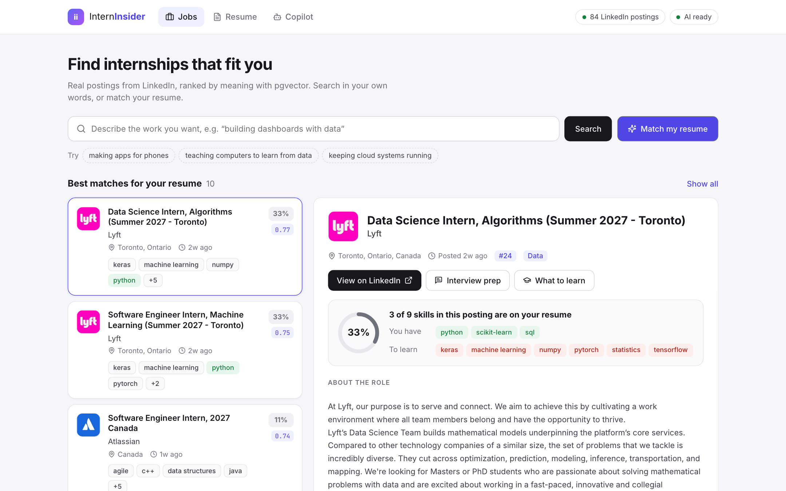
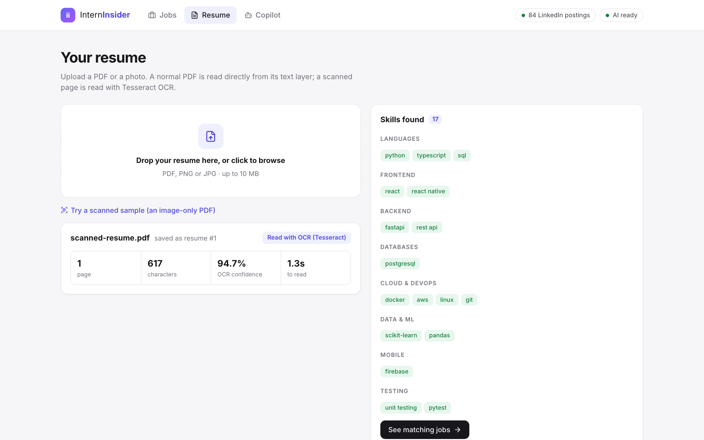
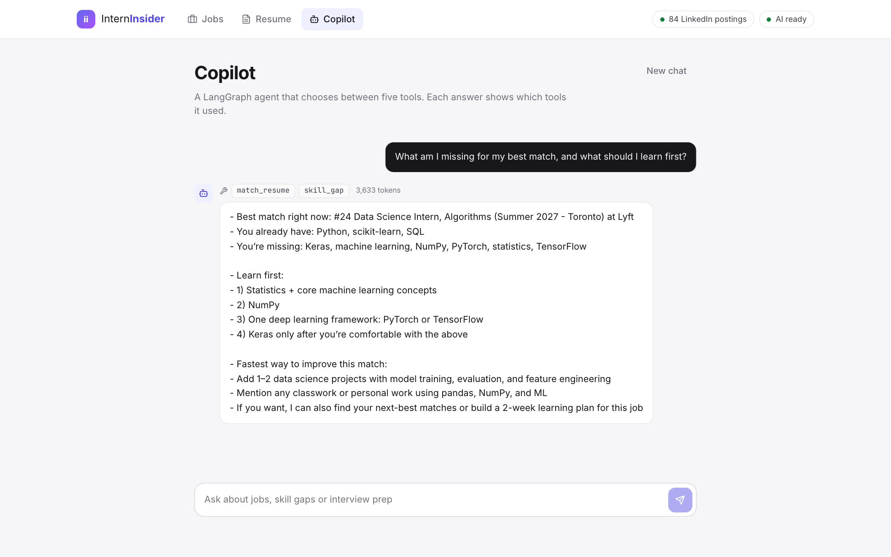

# InternInsider

A career copilot for students. Upload your resume (a PDF, or a photo of one) and it ranks real internship postings from LinkedIn by fit, shows which skills you have and which are missing for each posting, and answers questions through a LangGraph agent with five tools. The same tools are also served over MCP.

Stack: React + TypeScript, FastAPI, PostgreSQL with pgvector, LangGraph, MCP, Tesseract OCR.



## What it does

- **Jobs.** 84 internship postings from LinkedIn (Canada, November 2026). Search in your own words: "making apps for phones" finds mobile postings that never say "phones". "Match my resume" ranks postings against your whole resume, and each one shows the share of its skills that you have.
- **Resume.** Upload a PDF, PNG or JPG. A normal PDF has a text layer and is read directly. A scanned PDF or photo has no text, only pixels, so it is read with Tesseract OCR. The skills found are shown in groups.
- **Copilot.** Ask a question and a LangGraph agent picks which tools to call. Each answer shows the tools it used and how many tokens it cost.
- **Saved in PostgreSQL.** Every upload (file, read method, OCR confidence, text, skills) and every copilot answer (tools used, token counts) is stored. See them at http://localhost:8001/api/history.

| Resume read by OCR | Copilot with its tool calls |
|---|---|
|  |  |

## Results

- **Retrieval:** on the 84 postings and 24 test queries, pgvector raises Recall@5 from 0.211 (keyword search) to 0.284, a 35% relative gain. Run `python eval_retrieval.py` in `backend/`.
- **OCR:** on the scanned demo resume, Tesseract reads the text with 94.7% mean confidence and finds all 17 skills in about 1 second.
- **Tests:** 20 pass, with no API key and no network: `cd backend && python -m pytest -v`.

## How it works

```
LinkedIn job pages --> parse HTML --> find skills --> embed (384 numbers) --> PostgreSQL + pgvector
                                                                                    ^
Resume PDF/photo --> text layer, or OCR if it's a scan --> find skills              |
                                                                                    |
React app --> FastAPI --> 5 tools (plain Python + SQL) -----------------------------+
                  |          ^
                  +--> LangGraph agent (LLM picks the tools)
                             ^
                  MCP server (same 5 tools, for other AI apps)
```

## Run it (Mac with Homebrew PostgreSQL)

```bash
cd ~/InternInsdier
bash start-backend.sh     # terminal 1: Postgres, pgvector, Tesseract, packages, API on :8001
bash start-frontend.sh    # terminal 2: the React app on :5174
```

Open http://localhost:5174. For the copilot, put `OPENAI_API_KEY=sk-...` in `backend/.env` and restart the backend.

To fetch fresh postings from LinkedIn (about 5 minutes), then re-measure:

```bash
cd backend && source .venv/bin/activate
python -m app.ingest --linkedin            # fetch and save to data/linkedin_jobs.json
python -m app.ingest --linkedin --cached   # reload the saved file, no network
python eval_retrieval.py
```

API docs are at http://localhost:8001/docs while the backend runs.

## Demo (4 minutes)

1. Jobs: click "making apps for phones". Mobile postings come up without the word "phones".
2. Resume: drop in a real PDF resume. It says "Read from the PDF's text layer" and lists the skills.
3. Click "Try a scanned sample". It says "Read with OCR (Tesseract)" with about 95% confidence.
4. Jobs: click "Match my resume". Each posting shows a match %, and the panel shows "You have" and "To learn".
5. Copilot: ask "What am I missing for my best match, and what should I learn first?". The labels above the answer show which tools ran and the token count.
6. Open http://localhost:8001/api/history: the upload and the answer are saved in PostgreSQL.

## Files

```
backend/app/
  linkedin.py        fetch and parse LinkedIn's public job pages
  resume_parser.py   PDF/image to text: text layer first, OCR if there is none
  skills.py          the 114 skills and extract_skills()
  db.py              tables (jobs, resumes, chats), embeddings, saving results
  ingest.py          loading postings
  tools.py           the 5 tools
  agent.py           the LangGraph agent
  mcp_server.py      the same tools over MCP
  main.py            FastAPI endpoints
backend/eval_retrieval.py   Recall@5: keyword vs pgvector
frontend/src/pages/         JobsPage, ResumePage, CopilotPage
```

## About the LinkedIn data

LinkedIn has no jobs API for individuals, so `linkedin.py` reads the public job pages that anyone can see without logging in, waiting 1 to 2 seconds between requests. LinkedIn's terms do not allow scraping, so keep it to a small personal demo. The saved postings (`backend/data/linkedin_jobs.json`) are not committed. French-language postings are skipped (the embedding model is English-only), and a job listed in several cities is kept once.

Demo shortcuts: no login, and uploaded resumes are stored in the local database with no way to delete them from the app. A real version would need accounts, consent and deletion.
